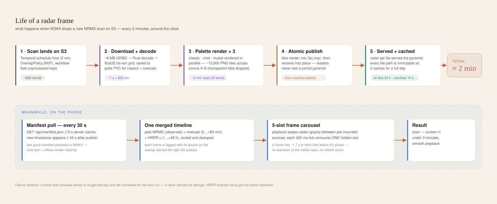
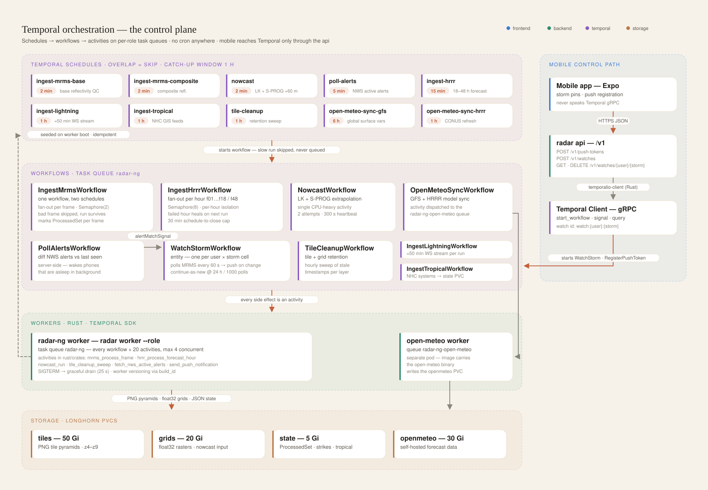
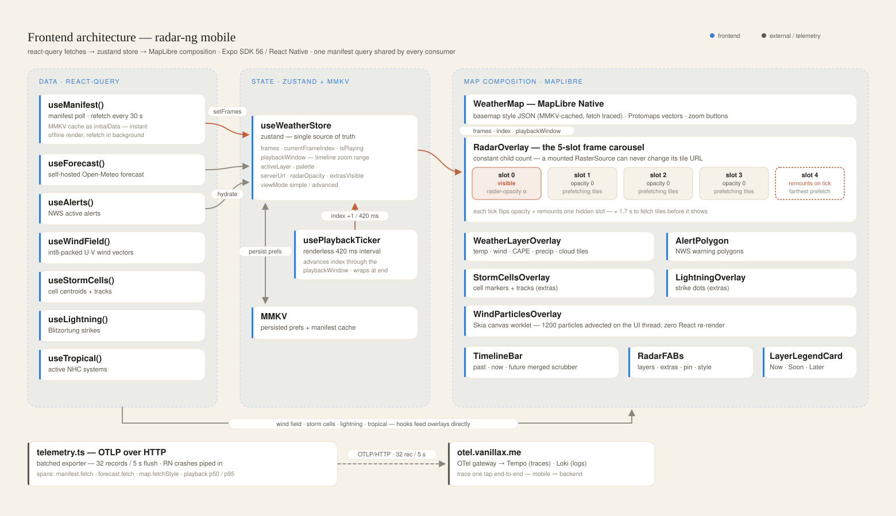
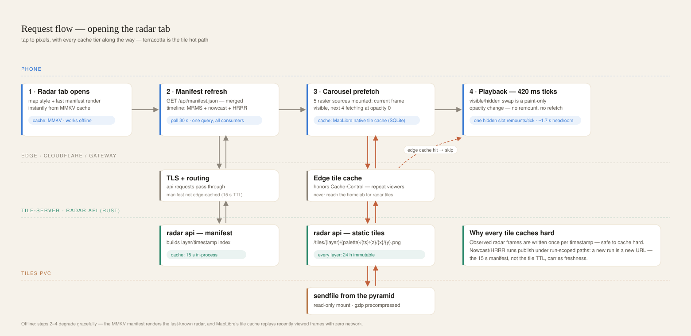
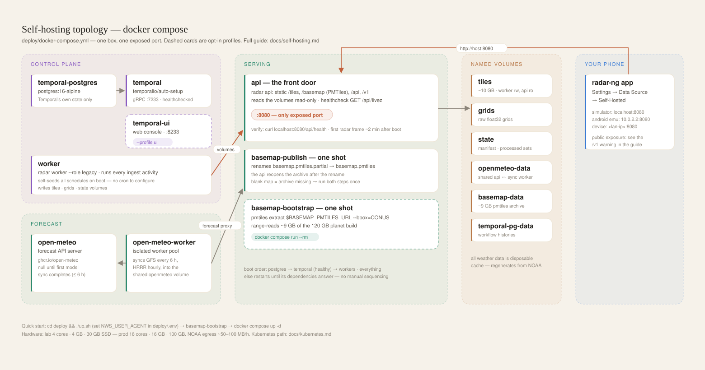

# Architecture

The phone app is the windshield; the Kubernetes pipeline is the engine. radar-ng pulls raw NOAA products (MRMS radar every 2 minutes, HRRR model runs hourly, lightning, tropical) onto hardware you own, rasterizes them into pre-rendered PNG tile pyramids on a PVC, and serves them as static files behind aggressive caching. Everything that runs on a timer is a Temporal Schedule driving a workflow; every workflow calls activities. The whole backend is one Rust binary, `radar` (workspace in `rust/`), run as the API, the workers, or an operator tool. The Expo app is deliberately thin: it polls one manifest, mounts raster sources over a MapLibre basemap, and keeps its own state in zustand + MMKV so it works offline and cold-starts instantly.

---

## The system at a glance

**Full system: NOAA sources → Temporal orchestration → ingest → PVC storage → tile-server → edge → clients.**

| component | what it is | what it does | key files |
|---|---|---|---|
| `frontend/` | Expo SDK 58 app (bun) | MapLibre map + Skia wind particles; react-query data hooks, zustand + MMKV state, opt-in OTel client | `src/components/map/RadarOverlay.tsx` · `src/lib/radarCarousel.ts` · `src/stores/useWeatherStore.ts` · `src/lib/telemetry.ts` |
| `web/` | the web radar (Vite) | browser radar on the same API | `src/` |
| `radar api` | the tile-server (`radar-api`) | serves tile pyramids as static files, the basemap (PMTiles, styles, fonts, imagery proxy), `/api/*` (manifest, forecast, inspect, alerts, geocode, metrics) and `/v1/*` (starts Temporal workflows for mobile) | `rust/crates/radar-api/` |
| MRMS ingest | `radar-ingest` + `radar-grib` + `radar-tiler` + `radar-storms` | list/download/decode 2-min MRMS GRIB2 frames, render 3-palette tile pyramids, detect and track storm cells; one prefix-driven code path serves both `radar` and `radar-composite` | `rust/crates/radar-ingest/src/mrms.rs` |
| HRRR ingest | `radar-ingest` | per-forecast-hour simulated reflectivity out to 18–48 h; secondary variables are capacity-gated (`HRRR_ENABLED_LAYERS`) | `rust/crates/radar-ingest/src/hrrr/` |
| air quality | `radar-aux::aqm` | NAQFC/AQMv7 bias-corrected PM2.5 + ozone (72 hourly messages per cycle, 06z/12z) rendered per-chunk into AQI-colored pyramids | `rust/crates/radar-aux/src/aqm/` |
| lightning | `radar-alerts::lightning` | long-running Blitzortung websocket activity, writes strikes to the state PVC | `rust/crates/radar-alerts/src/lightning/` |
| tropical | `radar-aux::tropical` | fetches NHC GIS feeds, publishes active systems | `rust/crates/radar-aux/src/tropical.rs` |
| nowcast | `radar-nowcast` | Lucas-Kanade motion + S-PROG extrapolation over recent MRMS grids → +60 min radar tiles, then skill scoring | `rust/crates/radar-nowcast/` |
| Open-Meteo sync | `radar-aux::open_meteo` | pulls GFS/HRRR open data into the self-hosted forecast API's volume; runs on its own worker pool | `rust/crates/radar-aux/src/open_meteo.rs` |
| tile cleanup | `radar-aux::tile_cleanup` | hourly deletion of expired tile timestamps + grids (manifest first, then the directory) | `rust/crates/radar-aux/src/tile_cleanup.rs` |
| data-plane library | `radar-core` + `radar-tiler` | atomic tile publication, palettes, manifest v2, `ProcessedSet` state, grid store, JSON logging, activity heartbeats | `rust/crates/radar-core/` · `rust/crates/radar-tiler/` |
| control plane | `radar-worker` + `radar-types` | worker roles, all 13 workflows, idempotent schedule seeding, watchdog, Worker Versioning | `rust/crates/radar-worker/` · `rust/crates/radar-types/src/schedules.rs` |
| `deploy/` | build and local deployment | the Dockerfile (api, worker, open-meteo targets), the compose stack, the release runbook | `Dockerfile` · `docker-compose.yml` · `RUNBOOK.md` |

Rule of thumb: **workflows orchestrate, activities do I/O.** Workflow code in `rust/crates/radar-worker/src/workflows/` contains no wall-clock, randomness, or I/O; every download, decode, render, and delete happens in an activity, and the activity bodies live in the domain crates with no Temporal types.

---

## Life of a radar frame

**Per-frame lifecycle: 2-min MRMS cadence, 3-palette parallel render, atomic publish.**

Every minute the `ingest-mrms-base` Schedule fires `IngestMrmsWorkflow` (a second schedule, `ingest-mrms-composite`, drives the same workflow with a different MRMS prefix). `OverlapPolicy.SKIP` means a slow run drops the next trigger instead of stacking.

1. **List** — `mrms_list_unprocessed_keys` scans the NOAA S3 prefix (~200 ms), diffs against the `ProcessedSet` on the state PVC, and returns up to `BACKLOG_PER_CYCLE=3` keys, **newest first** — fresh radar beats backfill.
2. **Download + decode** — `mrms_process_frame` GETs the `.grib2.gz` object and decodes it (pure-Rust GRIB2) to a float32 lat×lon grid.
3. **Render** — the grid is rasterized into a z4–z7 PNG pyramid once per configured palette. The honest z7 ceiling avoids spending most of the render budget magnifying the ~1 km MRMS source.
4. **Atomic publish** — the tiler renders into a unique sibling `<timestamp>.tmp-<uuid>` directory and renames it into an immutable final path. Concurrent retries cannot share or delete each other's staging directory, and existing final paths are never replaced. Forecast paths include their anchor/model run so two forecast cycles can never collide at the same valid time.
5. **Storm cells** — connected-component detection and tracking over the grid → one `storms.json`.
6. **Commit** — only after every configured palette has a non-empty pyramid, generation-pointer inspector and nowcast grids are written, manifest schema v2 publishes the frame metadata atomically, and the key is added to `ProcessedSet`.

One bad frame doesn't kill the run: per-frame errors are caught and logged, siblings continue, and the key is left unprocessed for the next cycle. The app discovers the new timestamp on its next manifest poll (≤30 s later).

Hot-path budget: the whole thing must land under the 2-minute MRMS cadence or `/api/health` flips to `degraded` (`MRMS_MAX_AGE_S=600`). The knobs that keep it under are in [docs/self-host/tuning.md](../self-host/tuning.md).

---

## Orchestration

**Temporal Schedules → workflows → activities → PVCs, plus the mobile → `/v1` → Temporal path.**

Everything periodic is a Temporal Schedule — there are no CronJobs and no crontabs. The seeding worker (one per deployment, `SEED_SCHEDULES=1`) create-or-updates all 12 schedules from `radar_types::schedules::all_schedules()` on boot (idempotent; compares before updating; retryable RPC errors are retried with bounded backoff). `radar seed` does the same once. Bringing up a fresh stack requires zero manual scheduling steps.

| schedule | workflow | cadence |
|---|---|---|
| `ingest-mrms-base` / `ingest-mrms-composite` | `IngestMrmsWorkflow` | 1 min (NOAA publishes every ~2 min) |
| `nowcast` | `NowcastWorkflow` | 2 min backstop; kicked by every new MRMS science grid |
| `poll-alerts` | `PollAlertsWorkflow` | 5 min |
| `ingest-hrrr` | `IngestHrrrWorkflow` | 15 min |
| `ingest-airquality` | `IngestAirQualityWorkflow` | 30 min (new cycles land 2×/day) |
| `ingest-lightning` | `IngestLightningWorkflow` | 60 min (activity streams ~50 min) |
| `ingest-tropical` | `IngestTropicalWorkflow` | 1 h |
| `tile-cleanup` | `TileCleanupWorkflow` | 1 h |
| `open-meteo-sync-hrrr` / `-gfs` / `-gfs025` | `OpenMeteoSyncWorkflow` | 1 h / 6 h / 6 h |

Why Temporal instead of CronJobs — the concrete list:

- **`OverlapPolicy.SKIP` + short catch-up windows.** A render that overruns its slot drops the next trigger instead of piling up; the 1–2 min schedules keep a 5-min catch-up window (hourly ones 1 h), so a worker that was down for an hour doesn't thundering-herd on recovery. Fresh data beats backfill for radar.
- **Retries with `schedule_to_close` budgets.** `start_to_close` bounds one attempt; `schedule_to_close` bounds the whole lifetime including retries and queue wait. `IngestHrrrWorkflow` gives each forecast hour 8 min per attempt but 12 min total (`rust/crates/radar-types/src/retry.rs`) — without the ceiling, repeated attempts on one sick input pin the run while SKIP silently drops every fresh trigger.
- **Coherent model publication.** HRRR hours render into immutable `runs/<run-id>/<valid-time>` paths. The workflow publishes and marks a run processed only when every consecutive required hour contains reflectivity, so clients cannot mix forecast cycles or see a partial run.
- **Heartbeats.** `radar_core::heartbeat` beats from the async runtime while CPU-bound work runs on a blocking thread. A hung worker is detected in the heartbeat timeout (nowcast: 120 s) instead of waiting out the full `start_to_close` (10 min).
- **Worker versioning.** Worker Deployments + `PINNED` (`rust/crates/radar-worker/src/worker.rs`): in-flight workflows finish on the build they started on, new runs go to the new build, and each build must pass `RadarDeploymentSmokeWorkflow` before the controller promotes it. The offline replay gate keeps the retained histories replaying.
- **Graceful drain.** SIGTERM or SIGINT stops polling, and in-flight activities get `TEMPORAL_GRACEFUL_SHUTDOWN_S` (default 25 s) to finish before cancellation, instead of being killed mid-write.
- **State on disk, not in history.** Processed-key sets live in `ProcessedSet` files on the PVC; workflow history carries only small payloads. Temporal history is an event log replayed on recovery, not a database.

**Role-aware worker pools.** Production runs five pools, `mrms`, `nowcast`, `hrrr`, `aux`, and `alerts`, each on its own queue (`USE_ISOLATED_TASK_QUEUES=1`), so a model fan-out cannot starve observed radar. The compose stack runs one `legacy` worker on the `radar-ng` queue instead. The Open-Meteo worker keeps its own queue (`radar-ng-open-meteo`) because its image carries the Open-Meteo binary.

**Mobile → Temporal.** The app never talks to Temporal directly. Workflow mutation routes are disabled in the cluster until a trusted identity issuer provides short-lived, per-user HMAC bearer tokens. When enabled, ownership checks bind every storm watch and push token to the authenticated subject; plaintext push credentials are stored outside immutable Temporal history.

---

## The app

**Self-hosted only.** Every request a client makes goes to the operator's own servers: the tile
server, plus, in this deployment, VersaTiles at `maps.vanillax.me` for the basemap, satellite
imagery and raster renders. The tile server fetches public data that clients need and serves it
itself: `/api/alerts` (NWS), `/api/geocode` and `/api/reverse-geocode` (a self-hosted Photon), and
`/basemap/imagery` (USGS orthoimagery). No API keys exist anywhere in the stack. See
[CONTRIBUTING.md](../../CONTRIBUTING.md#self-hosted-only).

**Hooks → zustand → MapLibre composition.**

**Data-flow rules.** All server data flows `react-query hook → zustand (useWeatherStore) → component`. Components never fetch. MMKV persists user prefs (server URL, theme, palette, extras — parsed with fallbacks on load, never cast) *and* the last manifest — `useManifestQuery` seeds react-query's `initialData` from MMKV with `initialDataUpdatedAt: 0`, so a cold start renders the radar instantly from cache and refetches immediately. That one query key (`["manifest", serverUrl]`) is shared by the radar tab, the home mini-map and Settings, so a single 30 s poll feeds all three; forecast, alerts, lightning, storms, and tropical each have their own hook and cadence. Every fetch carries a 10 s deadline chained to react-query's abort signal (`fetchWithTimeout`; Hermes has no `AbortSignal.timeout`). The root layout wires react-query's `focusManager` to `AppState`, so interval polling and the playback tick pause while the app is backgrounded and stale queries refetch on return.

**Storm-track prefetch.** Base-reflectivity ingest associates storm centroids across consecutive frames, keeps stable cell IDs, and extrapolates padded bboxes at 0, +5, and +10 minutes. `/api/storm-prefetch` ranks the nearest/highest-impact cell for the app's current location, resolves those three bboxes against published radar/nowcast frames, and returns only tile URLs that exist on disk. The iOS client gives the same three bboxes and minimal raster style URLs to MapLibre's native offline manager; ordinary JS HTTP/image prefetching is deliberately avoided because it does not warm MapLibre's native tile cache.

**Playback: a raster frame carousel, 5 slots wide.** A mounted MapLibre `RasterSource` cannot change its tile URL in place, so a frame advance is always a remount of *some* source. `RasterFrameCarousel.tsx` (shared by `RadarOverlay` and `WeatherLayerOverlay`) mounts `CAROUSEL_WINDOW` sources as a keyed array and assigns them frames with `assignSlots` (`lib/radarCarousel.ts`, pure and unit-tested): the visible slot holds the current frame at `raster-opacity: radarOpacity`, the others hold the next frames of the playback window at opacity 0 (still `visible`, so MapLibre fetches their tiles), and a +1 tick changes exactly one slot — the one that just played — so the remount always happens hidden, `(WINDOW-1)` ticks before that frame is shown. Playback defaults to 2 FPS (500 ms per frame); Settings allows 1–10 FPS, the range the timer honours, and the choice persists. Dragging the timeline commits a frame at most every 100 ms and always on release, since each committed frame remounts a source. The playback window (`{start,end}` of the 1h/48h zoom) is published by `TimelineBar` into `useWeatherStore.playbackWindow`, so the prefetch covers the loop wrap too.

`CAROUSEL_WINDOW` **defaults to 5** (since 2.1.4). It is fixed per build, never a runtime flag: `EXPO_PUBLIC_CAROUSEL_WINDOW=1` builds the old single-source tree as a kill switch (one remount per tick, frame blank until its tiles land). The default flipped after the iOS checklist — alerts present, extras toggled, layer and style switches, 1h↔48h zoom, server URL change, background/foreground — ran clean on the simulator; the physical-iPhone pass is part of the 2.1.4 release check. An earlier 7-source preload crashed iOS with `NSRangeException` in `[MLRNMapView insertReactSubview:atIndex:]` because the native child *count* churned; the carousel's constant, keyed, never-null slot array is the property that avoids it, and every other `<Map>` child now holds to the same rule — `AlertPolygon`, `TropicalOverlay`, `StormCellsOverlay` and `LightningOverlay` always mount their `GeoJSONSource` (an empty `FeatureCollection` when there is nothing to show; the extras toggle gates polling, not mounting) and the eyedropper `Marker` hides at opacity 0 instead of unmounting. Two count changes remain and are one-shot user actions, not per-tick: the overlay returns `null` until the first frames arrive (matches the pre-carousel behaviour; a placeholder source with no tiles was not verified on device), and switching layers swaps `RadarOverlay` for a `WeatherLayerOverlay`. The home `RadarMiniMap` keeps a plain single remounting source. Frame identity across manifest polls is the frame's `time`, not its index (`resnapFrameIndex`), so a poll that prunes the head does not move the paused frame.

Two clamps keep the wire quiet: `SOURCE_MAX_ZOOM` (MRMS: 7, nowcast/HRRR: 6) tells MapLibre the real pyramid ceiling so it upsamples the top tile instead of firing 404s at zooms that don't exist, and `SOURCE_MIN_ZOOM = 4` stops world-scale requests that CONUS-only coverage would never answer.

**Widget, CarPlay and Watch follow the app.** `useSharedStatePublisher` (mounted at the root) serialises the server URL, palette, temperature unit and location (`city` or `device`, rounded, with a label) into one JSON string (`lib/sharedState.ts`). The local Expo module `modules/radar-shared-state` writes it to the App Group `group.com.vanillax.radar-ng`, which the widget and CarPlay read, and pushes it to the Watch as WatchConnectivity application context, since App Groups don't cross devices. Each target reads it through the one `targets/_shared/RadarShared.swift`, which `@bacons/apple-targets` links into the app and every target. A city chosen in the app overrides the widget's and Watch's own GPS; the phone's device fix is only their fallback.

**Chrome.** Tabs are expo-router `NativeTabs`: the Liquid Glass bar with SF Symbols on iOS 26+ and a Material bar on Android, hidden on the full-screen radar route. Map controls render as `GlassView` through `MapChromeSurface` when Liquid Glass is available and Reduce Transparency is off, with translucent fills otherwise. Icons are `expo-symbols` (SF Symbols / Material Symbols).

Building and running the app: [docs/app/running-the-app.md](../app/running-the-app.md). Android releases: [docs/app/android-release.md](../app/android-release.md).

---

## Serving & caching

**Tap-to-pixels with every cache tier on the path.**

The tile-server is one process, `radar api` (axum). A radar frame is ~12.6k small PNGs on a PVC, and Envoy — the Gateway API data plane at the edge — routes but cannot serve files, so the api serves them itself from a static lane (`ServeDir` on `TILE_DIR`, no rate limit), next to the basemap lanes and the rate-limited `/api/*` and `/v1/*` routes.

| what | TTL | why |
|---|---|---|
| `/tiles/*` (observed and forecast layers) | **24 h, `immutable`** | observed MRMS frames are written exactly once per timestamp dir; forecast frames live under run-scoped paths (`runs/<run>/<valid-time>`), so a new run is a new URL — the playback loop replays frames without re-fetching a single tile |
| `/api/manifest.json` | 15 s server (`Cache-Control` + in-process TTL) / 30 s client poll | the freshness ceiling for discovering new frames |
| `/api/forecast/{lat}/{lon}` | `FORECAST_TTL_S` (default 900 s; the cluster sets 300) + in-process cache | Open-Meteo proxy; keyed per rounded coordinate |
| `/basemap/styles/*` / `/basemap/tiles/*` / `/basemap/fonts/*` | 1 h / 24 h / 7 d | static Protomaps assets |
| client offline | MMKV | last manifest + all prefs persist on-device; cold start renders before the network answers |

The caching story: **immutability comes from the path, not the layer.** Observed radar is append-only, and forecast runs get their own path, so every tile URL can be cached hard; the manifest (15 s) is what points clients at the newest frames and runs.

---

## Self-hosting shape

**The docker-compose stack — the same pipeline, one box.**

`deploy/docker-compose.yml` runs the same pipeline with containers standing in for pods: Temporal (auto-setup + postgres + optional UI), the `legacy` worker and the Open-Meteo worker, the `api`, self-hosted Open-Meteo, one-shot basemap bootstrap and publish steps, and named volumes standing in for the PVCs (tiles, grids, state, openmeteo-data, basemap-data). The api serves the basemap archive itself. The worker seeds all Schedules on boot — `docker compose up -d` is the entire orchestration setup.

| guide | one line |
|---|---|
| [docs/self-host/compose.md](../self-host/compose.md) | the golden path: Compose on one machine, ~10 minutes to first radar frame |
| [docs/self-host/kubernetes.md](../self-host/kubernetes.md) | bring-your-own-cluster: PVCs, probes, HPA, worker pools; the live manifests in talos-argocd-proxmox are the reference |
| [docs/self-host/tuning.md](../self-host/tuning.md) | every knob with a direction — zoom levels, palette count, worker concurrency, cadences |
| [docs/app/running-the-app.md](../app/running-the-app.md) | building the Expo dev client and pointing it at your server |

---

## Design decisions log

| decision | rationale |
|---|---|
| Tiles are files on a PVC, not object storage | ~12.6k small PNGs every 2 min is small-object churn that per-object PUT/GET overhead punishes; a directory `rename` is also the atomic commit primitive |
| z9 dropped from the radar pyramid | the top zoom level is ~75% of render wall-clock; with z9 frames arrived ~15 min stale, without it ~2 min — the client upsamples z8 instead (`SOURCE_MAX_ZOOM`) |
| Nowcast manifest uses replace-semantics | every nowcast run supersedes the last; incremental adds mixed fresh and stale vintages in one timeline (the atomic layer swap in `radar-nowcast`) |
| Frame carousel, opacity swap (5 slots) | constant native child count avoids the iOS `insertReactSubview` crash; swapping opacity instead of remounting kills refetch jank; `EXPO_PUBLIC_CAROUSEL_WINDOW=1` is the kill switch |
| Every tile path is immutable | observed frames are write-once and forecast runs are run-scoped paths → 24 h `immutable` for all `/tiles/*`; the manifest carries freshness |
| One Rust process serves tiles, basemap and API | Envoy at the edge routes but can't file-serve; the api's static lane serves PNGs and PMTiles without a proxy or sidecar |
| Temporal Schedules over K8s CronJobs | SKIP overlap, catchup window, retry budgets, heartbeats, and per-item isolation are the difference between "stale radar self-heals" and "pager duty" |
| Separate open-meteo worker pool | the sync activity needs the Open-Meteo binary in its image; registering it only on that worker makes Temporal do the routing |
| Ingest state in `ProcessedSet` files, not workflow history | history is a replayed event log, not a database; frame keys live on the PVC, history carries small dataclasses |
